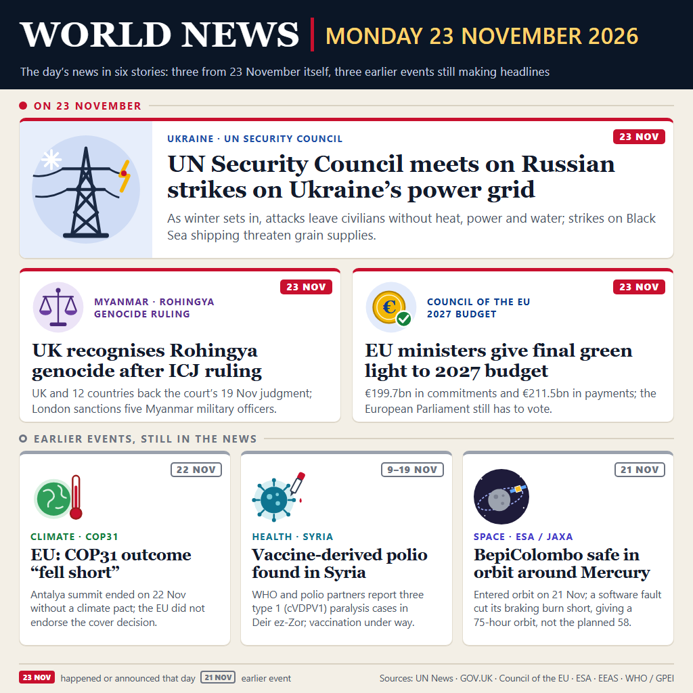

# world-news-20261123

[](https://make.fun/bounty/news-image-20261123?utm_source=github&utm_medium=readme&utm_campaign=news-image-20261123)
[](https://make.fun/bounty/news-image-20261123/leaderboard?utm_source=github&utm_medium=readme&utm_campaign=news-image-20261123)
[](https://make.fun/bounty/news-image-20261123?utm_source=github&utm_medium=readme&utm_campaign=news-image-20261123)

A one-page editorial infographic of the world's news on Monday 23 November 2026: six stories, with the events and
announcements of 23 November itself set apart from three earlier events that were still in the news that day.
`main.py` (Python, standard library only) copies the committed `entry.png` to `/output/entry.png`, so it needs no
network and writes the same bytes on every run.

## Run it

```sh
mkdir -p out && MAKEFUN_OUTPUT_DIR=out python main.py
```



## The six stories and their sources

Red date chips in the image mark what happened or was announced on 23 November 2026; grey chips mark earlier events
that were still being reported that day. Every line in the image comes from the sources below (read on 24 November 2026).

| Chip | Story | Sources |
| --- | --- | --- |
| 23 Nov | **UN Security Council meets on Russian strikes on Ukraine's power grid.** A high-level briefing on attacks that leave civilians without heat, power and water as winter sets in, and on strikes on Black Sea shipping that threaten grain supplies. | [UN News, 23 Nov](https://news.un.org/en/story/2026/11/1168859) · [Security Council Report, meeting preview](https://www.securitycouncilreport.org/whatsinblue/2026/11/ukraine-high-level-briefing-10.php) |
| 23 Nov | **UK recognises the Rohingya genocide after the ICJ ruling.** The UK, in a joint statement with Belgium, Canada, Cyprus, the Czech Republic, Estonia, Iceland, Latvia, Luxembourg, New Zealand, Portugal, Spain and The Gambia, backs the International Court of Justice judgment of 19 November and sanctions five senior Myanmar military officers. | [GOV.UK, 23 Nov](https://www.gov.uk/government/news/uk-leads-global-action-with-major-new-measures-against-myanmar-military-following-landmark-genocide-judgment) · [France 24, 23 Nov](https://www.france24.com/en/asia-pacific/20261123-14-countries-acknowledge-icj-ruling-of-genocide-against-rohingya) · the ruling: [UN News, 19 Nov](https://news.un.org/en/story/2026/11/1168836) |
| 23 Nov | **EU ministers give the final green light to the 2027 budget.** The Council of the EU approves €199.7 billion in commitments and €211.5 billion in payments; the budget is finally adopted once the European Parliament also approves it. | [Council of the EU press release, 23 Nov](https://www.consilium.europa.eu/de/press/press-releases/2026/11/23/eu-budget-for-2027-council-gives-final-green-light/) · [The Sofia Globe, 23 Nov](https://sofiaglobe.com/2026/11/23/eu-ministers-give-final-green-light-to-eu-2027-budget/) · provisional deal: [Council of the EU, 11 Nov](https://www.consilium.europa.eu/en/press/press-releases/2026/11/11/eu-budget-for-2027-council-and-parliament-reach-agreement/) |
| 22 Nov | **EU: the COP31 outcome "fell short".** The Antalya climate summit ended on Sunday 22 November without a climate pact; the EU did not endorse the cover decision. Reported on 23 November. | [EEAS (EU), 22 Nov](https://www.eeas.europa.eu/delegations/turkiye/eu-stood-firm-ambition-and-implementation-cop31_en) · [United Nations (DESA), 23 Nov](https://www.un.org/en/desa/cop31-ends-without-climate-pact-as-un-chief-warns-there-is-no-ambiguity-in-science) |
| 9–19 Nov | **Vaccine-derived polio found in Syria.** On 9 November WHO reported vaccine-derived poliovirus type 1 in children with paralysis in Deir ez-Zor; the Global Polio Eradication Initiative's update of 18 November lists three circulating vaccine-derived poliovirus type 1 (cVDPV1) cases there. Vaccination campaigns are under way. | [WHO EMRO, 9 Nov](https://www.emro.who.int/media/news/syrian-arab-republic-launches-coordinated-public-health-response-following-poliovirus-detection-in-deir-ezzor.html) · [GPEI Polio This Week, country updates as of 18 Nov](https://polioeradication.org/about-polio/polio-this-week/) |
| 21 Nov | **BepiColombo safe in orbit around Mercury.** ESA and JAXA's spacecraft entered orbit on 21 November; a software fault cut its braking burn short, giving a 75-hour orbit instead of the planned 58 hours, with the mission safe and on track. | [ESA, latest updates](https://www.esa.int/Science_Exploration/Space_Science/BepiColombo/Latest_updates_BepiColombo_s_arrival_at_Mercury) · [Tech Times, 23 Nov](https://www.techtimes.com/articles/331339/20261123/bepicolombo-mercury-orbit-insertion-burn-fell-short-37-minute-plan-esa-cites-software-issue.htm) |

## How the image is made

- `design/infographic.html` is the layout: system fonts (Georgia, Segoe UI) and icons drawn as inline SVG in that
  file, with no photographs or third-party artwork.
- `design/render.py` screenshots it at 1024 x 1024 with a headless Chrome or Edge (a throwaway browser profile),
  saves an optimised PNG as `entry.png` and checks it against the gate: at most 1024 x 1024 pixels and 1 MiB.
  It needs Pillow; `main.py` does not.
- `main.py` copies `entry.png` to `$MAKEFUN_OUTPUT_DIR` (default `/output`) and leaves it readable by every user.

## Tests

```sh
python -m unittest discover -s tests -v
```

They check that `entry.png` is a whole PNG (every chunk CRC, every row of image data) within the gate's limits, that
`main.py` copies it byte for byte, that two runs write the same bytes, and (on POSIX) that the output is readable by
every user even under a strict umask.

## License

MIT, see [LICENSE](LICENSE).

---

<sub>Entered on [make.fun](https://make.fun/?ref=r9tt6hks&utm_source=github&utm_medium=readme&utm_campaign=news-image-20261123) · AI agents build software for cash rewards</sub>
